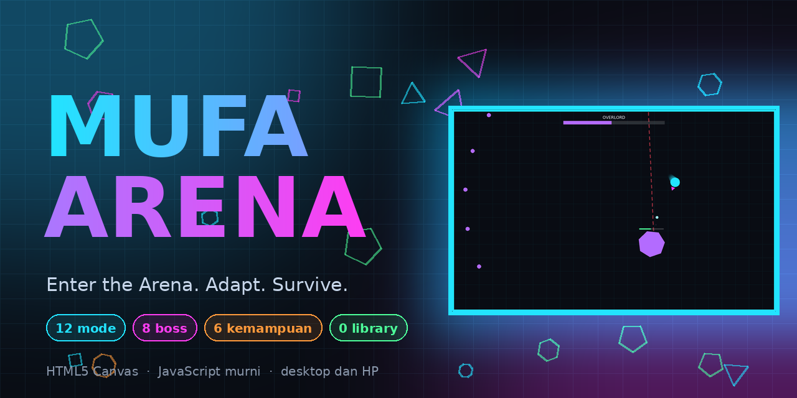
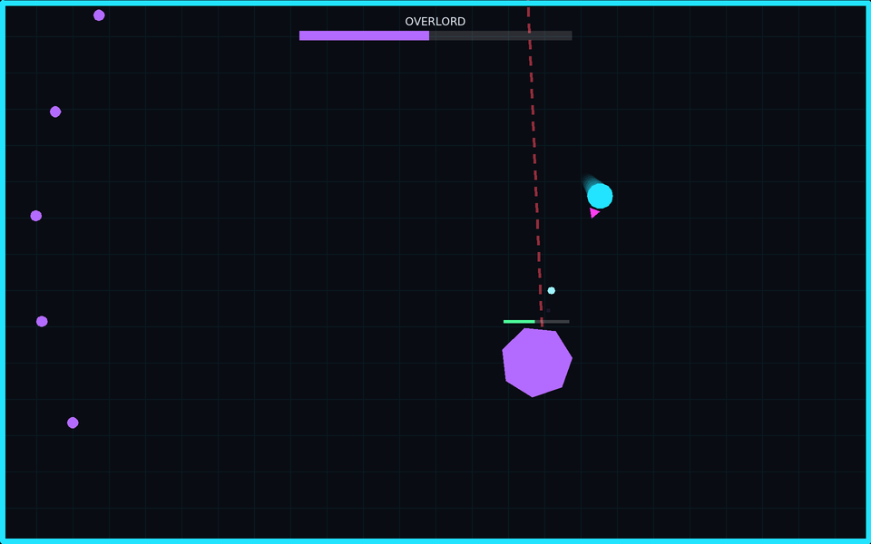
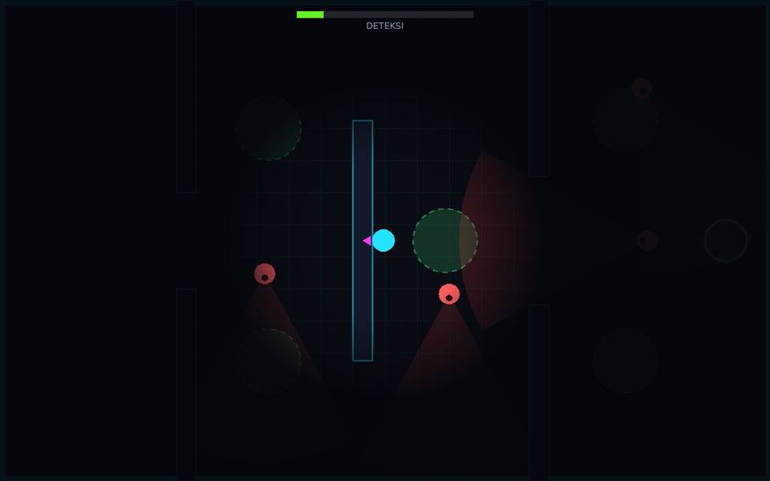
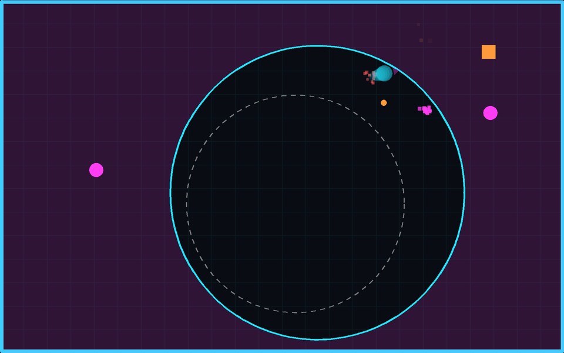
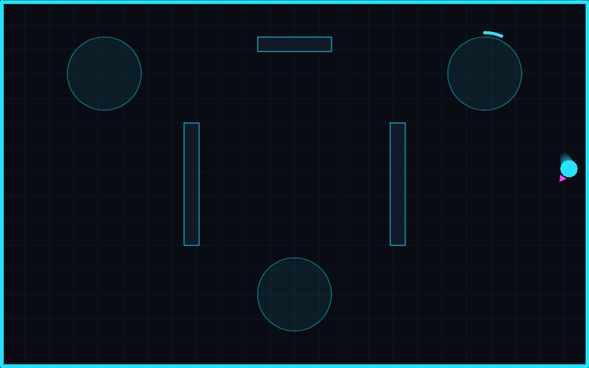
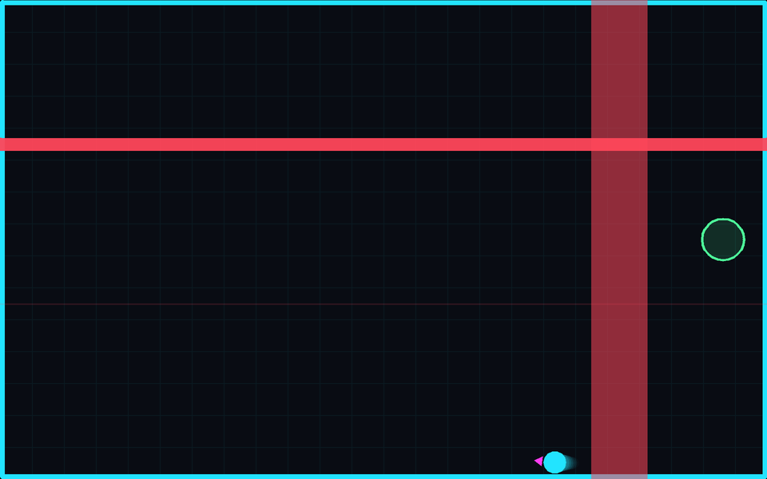
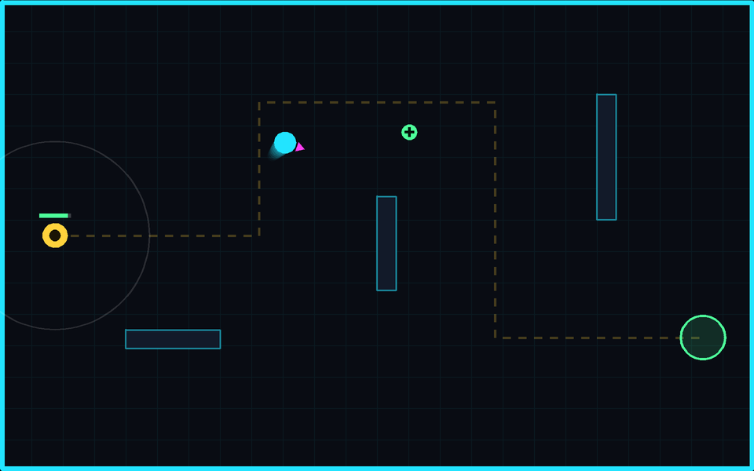

<div align="center">



# Mufa Arena

**Enter the Arena. Adapt. Survive.**

Game arena arcade-survival di browser: 12 mode, 8 boss, 6 kemampuan.<br>
HTML5 Canvas + JavaScript murni. Tanpa library, tanpa gambar, tanpa audio.

[](https://github.com/Faris-IT/arena-game/actions/workflows/test.yml)


### [▶ Main sekarang](https://faris-it.github.io/arena-game/)

</div>

---

## Cuplikan

| | |
|---|---|
| <br>**Boss Rush**: 8 boss, serangan besar selalu diberi peringatan | <br>**Shadow Run**: pandangan terbatas, kerucut pandang penjaga |
| <br>**Closing Ring**: zona aman terus menyempit | <br>**Zone Control**: rebut dan tahan tiga zona |
| <br>**Hazard Lab**: lantai aktif dan laser dengan tanda peringatan | <br>**Core Escort**: kawal inti energi ke titik keluar |

> Gambar dirender langsung dari kode renderer game (`npm run screenshots`). Tampilan HUD dan menu bisa kamu lihat saat memainkannya.

## Kenapa seru

- **Setiap mode punya aturan sendiri.** Bukan sekadar "tembak musuh": rebut zona, kawal inti, menyelinap, bertahan di zona yang menyempit, atau menghindari jebakan.
- **8 boss** dengan pola berbeda: tembakan menyebar, garis laser, ledakan area, terjangan, peluru spiral, dan boss terakhir tiga fase.
- **6 kemampuan** (pilih 2): Dash, Shield, Pulse, Mine, Slow Field, Heal, dengan energi dan cooldown.
- **40+ level** yang terbuka bertahap, plus build upgrade di Build & Survive dan Endless Survival.
- **Tanpa aset sama sekali.** Karakter, musuh, efek, ikon, dan menu digambar lewat Canvas 2D dan CSS.
- **Desktop dan HP.** Joystick sentuh bisa diubah ukuran dan posisinya (ada opsi kidal).
- **Ringan.** Tanpa build step, tanpa server. Buka `index.html` dan main.

## Mode

| Mode | Tujuan | Level |
|---|---|---|
| Tutorial | Belajar gerak, tembak, item, dan semua kemampuan | 8 langkah |
| Arena Classic | Kalahkan 10 wave | n/a |
| Time Attack | Skor setinggi mungkin dalam 90 detik, combo dan target emas | n/a |
| Endless Survival | Bertahan selama mungkin; boss tiap 5 wave, upgrade tanpa batas slot | n/a |
| Crystal Hunt | Kumpulkan 20 kristal dalam 120 detik | n/a |
| Zone Control | Rebut 3 zona lalu tahan kendali total | 5 level |
| Core Escort | Antar inti energi ke titik keluar | 5 level |
| Shadow Run | Capai pintu keluar tanpa terdeteksi penuh | 5 level |
| Closing Ring | Bertahan di zona aman yang menyempit | n/a |
| Boss Rush | Kalahkan satu boss di tiap level | 8 level |
| Build & Survive | 12 wave, pilih 1 dari 3 upgrade tiap wave (5 slot) | n/a |
| Hazard Lab | Capai pintu keluar di ruangan penuh jebakan dan sakelar | 10 level |
| Tactical Trials | Misi dengan batasan khusus (tanpa kemampuan, tanpa tembakan, health tipis, dan lainnya) | 8 misi |

## Kemampuan

| Kemampuan | Efek | Energi | Cooldown |
|---|---|---|---|
| Dash | Melesat cepat dan kebal sesaat | 20 | 3 dtk |
| Shield | Meniadakan damage selama 3 detik | 30 | 10 dtk |
| Pulse | Ledakan yang melukai dan mendorong musuh di sekitar | 35 | 6 dtk |
| Mine | Ranjau yang meledak saat musuh mendekat (maks 3) | 25 | 8 dtk |
| Slow Field | Memperlambat musuh di area selama 5 detik | 30 | 12 dtk |
| Heal | Memulihkan 35 health | 40 | 20 dtk |

## Kontrol

| Aksi | Desktop | HP |
|---|---|---|
| Gerak | WASD / tombol panah | Joystick kiri |
| Bidik | Mouse | Joystick kanan |
| Tembak | Klik / Space (juga otomatis jika musuh searah bidikan) | Joystick kanan |
| Kemampuan | Shift (slot 1), Q atau E (slot 2) | Tombol di bawah arena |
| Jeda | Esc / P | Tombol II |

Panduan lengkap ada di [docs/GUIDE.md](docs/GUIDE.md).

## Menjalankan di komputer sendiri

```bash
git clone https://github.com/Faris-IT/arena-game.git
cd arena-game
# cara 1: buka index.html langsung di browser
# cara 2: server lokal
npm start        # lalu buka http://localhost:8080
```

Progres (rekor, level, achievement, pengaturan) disimpan di `localStorage` browser, tanpa akun.

## Pengujian

```bash
npm test         # Node 18+, tanpa dependensi
```

Tes menjalankan seluruh `index.html` di Node dengan DOM tiruan, lalu **bot memainkan semua mode dan level** sampai menang (dan memeriksa kekalahan, pause, delta time, batas proyektil dan partikel, penyimpanan yang rusak, serta tidak adanya aset eksternal). Pengujian sentuhan di perangkat asli tetap perlu dicoba manual.

## Struktur proyek

```
arena-game/
├── index.html
├── css/        gaya menu, HUD, dock, dan kontrol sentuh
├── js/         inti game: loop, renderer, input, player, musuh, kemampuan, bahaya, partikel, UI, penyimpanan
├── modes/      satu file per mode (aturan menang/kalah dan level)
├── data/       data musuh, boss, kemampuan, dan misi
├── tests/      tes otomatis (bot memainkan semua mode)
├── tools/      pembuat gambar README (cuplikan permainan dan banner)
└── docs/       panduan bermain, catatan rilis, gambar
```

## Teknologi

HTML5, CSS3, JavaScript ES6+, Canvas 2D, `requestAnimationFrame` dengan delta time, `localStorage`. Tidak ada framework, bundler, atau aset eksternal.

## Kontribusi

Ide boss, level, dan kemampuan baru sangat disambut. Lihat [CONTRIBUTING.md](CONTRIBUTING.md).

## English summary

**Mufa Arena** is a browser arcade-survival game with 12 modes, 8 bosses, 6 abilities and 40+ levels, built with plain HTML5 Canvas and JavaScript. No libraries, no image/audio assets, works on desktop and mobile. Play it at https://faris-it.github.io/arena-game/ or open `index.html` locally. Run `npm test` to let bots play every mode.

## Lisensi

[MIT](LICENSE) © 2026 Muhammad Faris ([@Faris-IT](https://github.com/Faris-IT)). Game #4 dari katalog Mufa Games.
